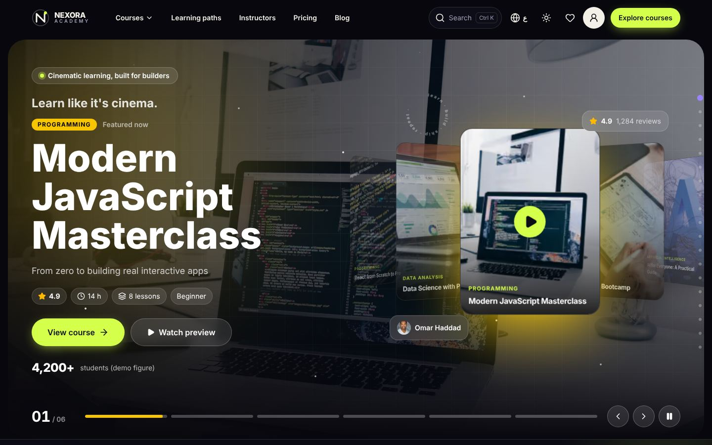
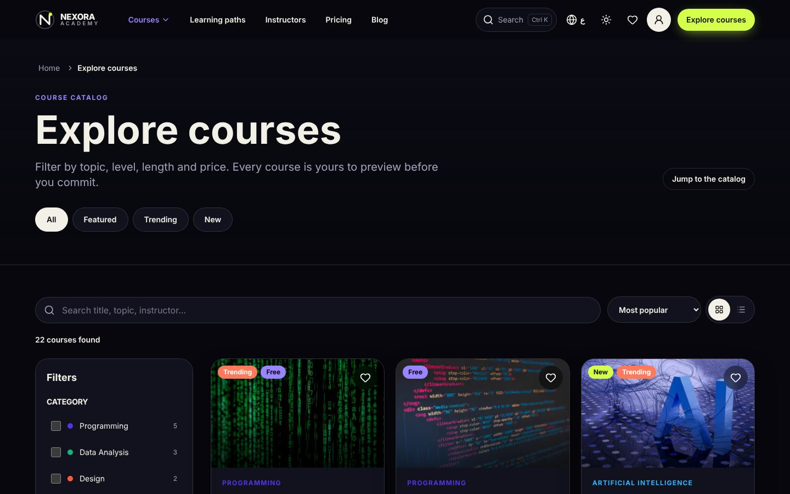
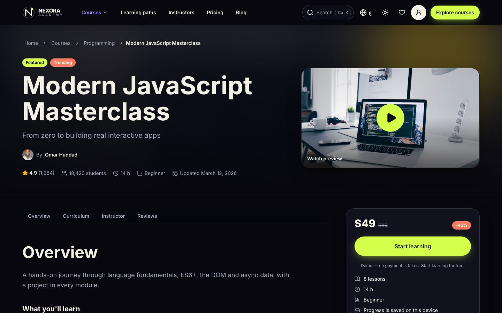
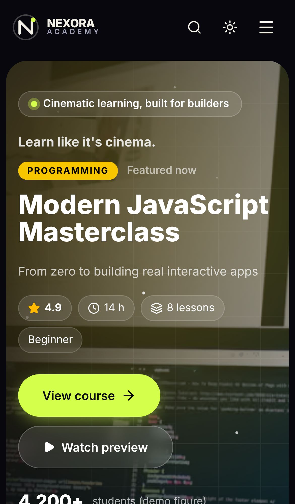
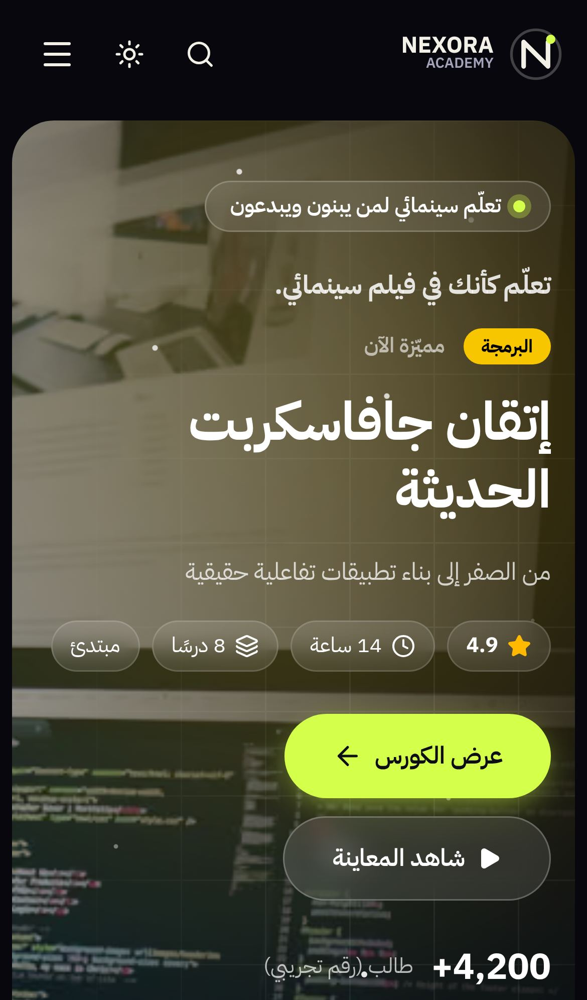

<div align="center">

# NEXORA Academy

**A cinematic, bilingual (English / Arabic RTL) e-learning platform — front-end concept built with Next.js 16 and React 19.**

[](https://github.com/Eslamraafat1/Courses-N/actions/workflows/e2e.yml)


[**Live Demo**](https://courses-n.vercel.app) · [Portfolio](https://new-portfolio-ashy-xi.vercel.app) · [LinkedIn](https://www.linkedin.com/in/eslamraafat-dev/)



</div>

## Screenshots

| Course catalogue (desktop) | Course page (desktop) |
|---|---|
|  |  |

| Mobile — English (iPhone 13) | Mobile — Arabic RTL (iPhone 13) |
|---|---|
|  |  |

## Overview

NEXORA Academy is a **concept / portfolio project**: the full front end of an online-course platform — marketing home page, course catalogue, course pages, lesson player, learning paths, student dashboard and an admin UI preview — in **English and Arabic** with a proper right-to-left layout.

It runs on **demo data** (22 courses across 10 categories) served through a typed data-access layer and local Next.js Route Handlers, and is designed so a real backend can be plugged in through environment variables without touching UI components.

> **Honest scope:** there is no real authentication, payment, e-mail delivery or server-side persistence. Forms validate and then tell the user that nothing was sent; progress, wishlist and notes are stored in `localStorage`. Courses, people and figures are demo data.

## Key Features

**Learning experience**
- Course catalogue with live search, multi-facet filters (category, level, duration, price, rating, instructor), sorting, grid/list view and **URL-synced state** (shareable, back-button friendly)
- Course pages with curriculum, instructor, reviews and certificate preview, plus a quick-view shared-layout transition from the catalogue
- Lesson player (YouTube / Vimeo / MP4, modal and inline) with locally saved progress and notes, and "continue where you stopped"
- Learning paths, categories, instructors, blog, pricing, FAQ, help centre, contact and legal pages

**Internationalisation & theming**
- Locale-prefixed routes (`/en/...`, `/ar/...`) with server-rendered `<html lang dir>`; the language switch keeps the current page and is remembered in a cookie
- Logical CSS (start/end) so the whole UI mirrors in RTL; the Arabic font is only loaded on Arabic pages
- Light / dark theme without a flash of the wrong theme

**Motion & UI**
- Cinematic course-carousel hero and 19 animated home sections (GSAP ScrollTrigger, Framer Motion, Lenis smooth scroll)
- A lazily loaded React Three Fiber scene that only mounts when WebGL is available
- Command palette (Ctrl/⌘ K), toasts, accessible modals and bottom sheets, scroll progress and a section indicator

**Accounts & admin (UI only)**
- Login / register / forgot / reset forms validated with **React Hook Form + Zod**
- Student area: dashboard, my learning, continue, wishlist, recently viewed, notifications, profile, settings
- Admin UI preview: overview charts, courses (with course builder), lessons, categories, instructors, students, reviews, homepage, settings — edits are not saved

## Tech Stack

| Area | Tools |
|---|---|
| Framework | Next.js 16.4 (App Router, Cache Components, Partial Prerendering, `proxy.ts` locale routing) |
| UI | React 19.3, TypeScript 5.9 (strict), Tailwind CSS 4 |
| Motion / 3D | GSAP 3 + ScrollTrigger, Framer Motion, Lenis, Three.js + React Three Fiber / Drei, animate.css (selected keyframes) |
| Forms & validation | React Hook Form, Zod 4 (client forms and API Route Handlers) |
| Icons | lucide-react |
| Quality | Playwright (desktop + mobile Chrome), ESLint, `tsc` |
| CI / Hosting | GitHub Actions, Vercel |

## Architecture Highlights

```
UI (pages / sections / components)
  └─ @/lib/api              server data access: getCourse(), getCourses(), getCategories() …
       ├─ source.ts         demo ⇄ backend switch (env-driven)
       ├─ demo/service.ts   in-memory "backend" over data/demo/*
       ├─ remote.ts         cached ("use cache") GET requests to NEXT_PUBLIC_API_BASE_URL
       ├─ mappers.ts        wire DTO ⇄ UI domain types (the only place that knows both)
       └─ types / endpoints / errors / config / client / browser
app/api/*                   demo Route Handlers (courses, lessons, reviews, categories,
                            instructors, search, contact, newsletter) with Zod validation
```

- **Demo ⇄ backend switch** by environment variables only; the proposed API contract is in [`docs/BACKEND_INTEGRATION.md`](docs/BACKEND_INTEGRATION.md).
- **Locale routing** in `proxy.ts`: locale-less URLs redirect to the saved language (cookie) or the browser's `Accept-Language`, defaulting to Arabic.
- **Static generation**: every locale × course / category / path / instructor / post page is prerendered at build time (~725 static routes).
- **Typed i18n dictionaries** (`lib/i18n`) with a `t()` helper on server and client.

## SEO & Performance

- Per-page `<title>`, description, **absolute canonical URL** and `hreflang` alternates (`en`, `ar`, `x-default`)
- The site URL resolves from `NEXT_PUBLIC_SITE_URL` → Vercel's production domain → `https://courses-n.vercel.app`, so production HTML can never point at `localhost`
- Open Graph / Twitter cards: course and category pages use their own image, every other page a generated 1200×630 card (`app/[lang]/opengraph-image.tsx`)
- JSON-LD: `EducationalOrganization` + `WebSite` (with `SearchAction`) on the home page, `Course` + `BreadcrumbList` on course pages, `BreadcrumbList` on category pages, plus `ItemList`, `FAQPage`, `Article` and `Person` where relevant
- `sitemap.xml` (both locales with `hreflang` alternates, private pages excluded) and `robots.txt` (blocks `/admin` and `/api/`)
- Dashboard, auth, admin and search pages are `noindex`; unknown URLs return a localised, branded **404**
- `next/image` (AVIF/WebP), `next/font` with only the active locale's fonts, lazy-loaded Lenis and 3D scene, `optimizePackageImports` for heavy libraries

## Testing & QA

End-to-end tests live in [`e2e/`](e2e): **34 Playwright tests**, run on desktop Chrome and mobile Chrome (Pixel 7). The 7 SEO checks inspect server HTML and run once, so a full run is **61 test executions**.

| Spec | Tests | What it covers |
|---|---|---|
| `smoke.spec.js` | 10 | Key pages return 200 with the right title; EN is LTR, AR is RTL; unknown routes 404 |
| `catalog.spec.js` | 5 | Search narrows results and writes `?q=` to the URL; empty state + "Clear all"; deep-link restore; sort; level filter (sidebar on desktop, bottom sheet on mobile) |
| `course.spec.js` | 3 | Catalogue → course page; page sections; "Start learning" opens the lesson player |
| `forms.spec.js` | 3 | Sign-up validation (required fields, invalid e-mail, short password, mismatch, terms) and the valid-submit notice |
| `i18n.spec.js` | 3 | Language switch → `lang="ar" dir="rtl"` on the same page; choice remembered via cookie; Arabic is server-rendered RTL |
| `seo.spec.js` | 7 | Canonical/hreflang absolute and never localhost; OG image is a 1200×630 PNG; JSON-LD parses (Organization, WebSite, Course, BreadcrumbList); robots.txt; sitemap.xml; `noindex` on private pages |
| `errors.spec.js` | 3 | Branded 404 with correct status, `lang` and `dir`; unknown course slug |

**CI** ([`.github/workflows/e2e.yml`](.github/workflows/e2e.yml)) runs on every push to `main` and every pull request: `npm ci` → **lint** → **type-check** → **production build** → start the build → **E2E suite against that local build**. It can also be triggered manually against any URL (e.g. the live site).

```bash
# run the suite against a local production build
npm run build && npm start                  # terminal 1 → http://localhost:3000
cd e2e && npm ci && npx playwright install chromium
BASE_URL=http://localhost:3000 npm test     # terminal 2
npm test                                    # or against the live site (default)
```

## Project Structure

```
app/
  [lang]/(site)/               public pages: home, courses, categories, paths, instructors, blog, learn, dashboard …
  [lang]/(admin)/              admin UI preview (noindex)
  [lang]/layout.tsx            root layout: <html lang dir>, fonts, providers
  [lang]/opengraph-image.tsx   default social card
  api/                         demo Route Handlers (Zod-validated)
  sitemap.ts, robots.ts
components/                    sections, ui, courses, learn, dashboard, admin, navigation, animations, three, video …
data/                          demo content (courses, categories, instructors, paths, pricing, legal …)
lib/
  api/                         data-access layer (demo ⇄ backend)
  i18n/                        locale config + EN/AR dictionaries
  site.ts                      site URL, metadata and JSON-LD helpers
hooks/, types/
proxy.ts                       locale detection / redirect
e2e/                           Playwright tests (separate package)
docs/                          backend contract, screenshots
```

## Getting Started

**Requirements:** Node.js ≥ 20.9 and npm.

```bash
git clone https://github.com/Eslamraafat1/Courses-N.git
cd Courses-N
npm ci
cp .env.example .env.local   # optional: the defaults run demo mode
npm run dev                  # http://localhost:3000
```

| Script | Description |
|---|---|
| `npm run dev` | Start the dev server |
| `npm run build` | Production build |
| `npm start` | Serve the production build |
| `npm run lint` | ESLint |
| `npm run typecheck` | Generate route types and run `tsc --noEmit` |

**Environment variables** (see [`.env.example`](.env.example); all optional):

| Name | Default | Purpose |
|---|---|---|
| `NEXT_PUBLIC_USE_DEMO_API` | `true` | `false` switches to backend mode |
| `NEXT_PUBLIC_API_BASE_URL` | — | Real API base URL (backend mode only) |
| `NEXT_PUBLIC_SITE_URL` | Vercel production domain, then `https://courses-n.vercel.app` | Origin for canonical, hreflang, sitemap, OG and JSON-LD |
| `API_FALLBACK_TO_DEMO` | `false` | Server-only: let a production build fall back to demo data if the backend is down |

## Deployment

Deployed on **Vercel** from `main` at [courses-n.vercel.app](https://courses-n.vercel.app). No configuration is required: without `NEXT_PUBLIC_SITE_URL` the app uses Vercel's production domain for absolute URLs. Set `NEXT_PUBLIC_SITE_URL` if a custom domain is added.

## Limitations & Roadmap

Needs a real backend (UI only today): authentication and roles, payments/subscriptions, contact/newsletter delivery, saving admin edits, reviews/Q&A, certificates, cross-device progress and wishlist, notification delivery, uploads.

Known limitations:
- Image/video hosts must be allow-listed in `next.config.ts` (`images.unsplash.com`, `i.ytimg.com`).
- Auto-advance after a lesson works for MP4 only (YouTube/Vimeo embeds do not report completion).
- With Partial Prerendering, an unknown *course slug* is detected after streaming has started: browsers get the branded 404 page, but non-browser clients may see status 200 (the page still carries `noindex`). Unknown routes always return 404.

<!-- more-projects:start -->
## More of my work

| Project | What it is | Demo |
|---|---|---|
| **[VANTA](https://github.com/Eslamraafat1/E-commerce-New-)** | 3D bilingual e-commerce storefront | [Live](https://e-commerce-new2-delta.vercel.app/en) |
| **[Atlas Estates](https://github.com/Eslamraafat1/New-Real-Estate)** | 3D real estate platform | [Live](https://new-real-estate-jade.vercel.app) |
| **[Crust & Crave](https://github.com/Eslamraafat1/New-Restaurant)** | cinematic restaurant storefront | [Live](https://new-restaurant-kappa.vercel.app) |
| **[Nubia](https://github.com/Eslamraafat1/Perfume)** | perfume store on Supabase | [Live](https://perfume-sooty-alpha.vercel.app) |
| **[MONOLITH](https://github.com/Eslamraafat1/3D-Website-)** | 3D architecture studio site | [Live](https://3-d-website-seven-xi.vercel.app) |
| **[Tour Egypt Club](https://github.com/Eslamraafat1/Travel)** | client travel & tours website | [Live](https://touregyptclub.com) |
| **[Portfolio](https://github.com/Eslamraafat1/new-portfolio)** | bilingual Next.js portfolio | [Live](https://new-portfolio-ashy-xi.vercel.app) |

See everything on my [GitHub profile](https://github.com/Eslamraafat1) and [portfolio](https://new-portfolio-ashy-xi.vercel.app/).
<!-- more-projects:end -->

## Author

**Eslam Raafat** — Front-End Developer

- Portfolio: [new-portfolio-ashy-xi.vercel.app](https://new-portfolio-ashy-xi.vercel.app)
- LinkedIn: [linkedin.com/in/eslamraafat-dev](https://www.linkedin.com/in/eslamraafat-dev/)
- GitHub: [@Eslamraafat1](https://github.com/Eslamraafat1)
- Email: [eslamraafat736@gmail.com](mailto:eslamraafat736@gmail.com)

## License

[MIT](LICENSE) © 2026 Eslam Raafat. Course images are from Unsplash; courses, people and figures are demo data.

---

<sub>Contributor note: this project uses Next.js 16, whose APIs differ from older versions — read [`AGENTS.md`](AGENTS.md) and the guides in `node_modules/next/dist/docs/` before changing framework-level code.</sub>
